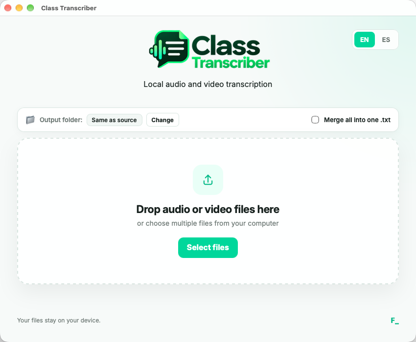

# Class Transcriber


A macOS desktop app that transcribes audio and video files on your own computer with [whisper.cpp](https://github.com/ggml-org/whisper.cpp). Nothing is sent to a cloud service, and you don't need an account or a subscription.



It wraps `whisper.cpp` and `ffmpeg` in a native app built with Tauri, so you can transcribe lectures and other recordings without sending them to a third-party API.

## Features

- Queue several files at once, by selecting them or dropping them in. They are processed one after another, each with its own progress bar.
- Merge all the transcripts into a single text file, with delimiters and a title for each section. The merged file is offered when the queue finishes, or whenever you ask for it.
- Save transcripts next to the source files or in a folder you choose.
- Models are found automatically in `~/whisper-models/` and the standard system paths. It works with `ggml-medium.bin`, the large, small, base and tiny models, or a custom model file.
- The interface is in English and Spanish.
- Common video and audio formats work without converting them first.

## Supported formats

- Video: MP4, MOV, M4V, MKV, WebM, AVI
- Audio: MP3, WAV, M4A, AAC, FLAC, OGG

## Requirements

The current macOS build relies on local system binaries:

1. FFmpeg, to extract and resample the audio:
   ```bash
   brew install ffmpeg
   ```
2. The whisper.cpp CLI (`whisper-cli`):
   ```bash
   brew install whisper-cpp
   ```
3. A Whisper GGML model. Put the model files in `~/whisper-models/` (for example, `ggml-medium.bin` or `ggml-large-v3-turbo.bin`):
   ```bash
   mkdir -p ~/whisper-models
   curl -L -o ~/whisper-models/ggml-medium.bin https://huggingface.co/ggerganov/whisper.cpp/resolve/main/ggml-medium.bin
   ```

## Installation on macOS

### From source

You need Node.js (v18+), Rust and the Xcode Command Line Tools. Clone the repository and run the installation script:

```bash
git clone https://github.com/fabianubv/class-transcriber.git
cd class-transcriber
./install.sh
```

The script installs the npm dependencies if they are missing, compiles the release binary and installs `Class Transcriber.app` into `/Applications`.

### Building a disk image

To package a standalone `.dmg` installer:

```bash
./build-dmg.sh
```

The script writes `Class-Transcriber.dmg` to the project root.

## Development

Prerequisites:
- Node.js (v18+)
- Rust and Cargo
- Xcode Command Line Tools (on macOS)

```bash
# Clone the repository
git clone https://github.com/fabianubv/class-transcriber.git
cd class-transcriber

# Install dependencies
npm install

# Run in development mode
npm run tauri dev
```

To build a standalone release without installing:

```bash
npx tauri build
```

## Privacy

Class Transcriber processes all media on your machine.

- No telemetry or analytics.
- No network requests during transcription.
- No transmission of user audio, video, transcripts, or directory metadata.

## Platform support

- macOS: supported and tested on Apple Silicon and Intel.
- Windows and Linux: planned.

## License

MIT License. See [LICENSE](LICENSE) for details.
